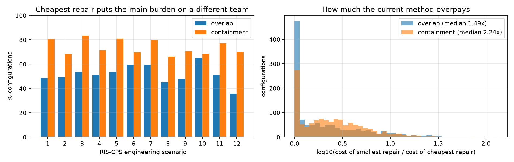
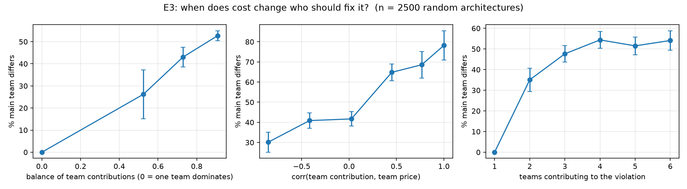

# Who should fix it? Cost-aware, certified repair of uncertainty requirements

A research prototype for the TUM thesis topic *Who Should Fix It? Cost-Aware Repair of Uncertainty Requirements in Multi-Model Architectures* (Data Engineering, TUM Heilbronn). I built it before applying, to scope the problem and to test the central question early: **does putting realistic costs on the repair step change who should fix an inconsistency?**

It builds on the set-based consistency formulation of Mäkelburg, Schwabe & Acosta, *Estimating Inconsistency Response Surfaces under Uncertainty in CPS Development* (ICDM 2026, [arXiv:2609.11331](https://arxiv.org/abs/2609.11331)). Their consistency recourse looks for the *smallest* intervention, `argmin ‖θ − θ*‖₂`, so every team's change is weighted the same. This prototype replaces that distance with costs and keeps every answer certified.

## What it does

| Thesis goal (from the topic) | Status in this prototype |
|---|---|
| Define cost models: unit, proportional, sources that cannot be revised (Master: piecewise-linear convex) | ✅ all four, plus per-lever prices (shrink vs. shift vs. relax) and "cannot do that" (∞ price) |
| Cost-aware repair and price-of-restriction queries, keeping certified results | ✅ an exact LP for constrained zonotopes; every optimum certified by LP duality and independently re-verified |
| Compare against the current method on example systems | 🟡 the 12 IRIS-CPS engineering scenarios with the paper's own Saltelli interventions (2,654 configurations); the 11-domain corpus is not public yet |
| How often, and why, the cost model changes the repair | 🟡 preliminary answers for both (E2, E3) |
| (Master) which system structures make the choice matter | 🟡 preliminary: logistic model over 2,500 random architectures (E3) |

### Model
- **Architecture.** Models connected by affine *uncertainty mappings* (an acyclic graph). Each model owns a constrained zonotope `{c + Gξ : Aξ = b, ξ ∈ [-1,1]}`; the whole system is one global constrained zonotope.
- **Levers, each owned by a team:** shrink or widen an uncertainty source (σ_k), shift a model's center (recalibration), shift or widen a target model, or relax a requirement.
- **Requirements:** `Bound` (worst case ≤ β), `Variability` ("may vary by at most ε"), `BoxContainment` (every realization consistent, I = 0), and `Overlap` (joint consistency as in Def. 2 of the paper, I < 1).
- **Certification.** The support function of a constrained zonotope is an LP. Its dual, `min bᵀλ + 1ᵀ(μ⁺+μ⁻) s.t. Aᵀλ + μ⁺ − μ⁻ = a∘σ`, is **linear in the repair variables σ**. So "the requirement holds after repair" becomes linear constraints, and any feasible (λ, μ) is a proof (weak duality). The whole repair is a single LP whose optimality is certified by a zero duality gap. Overlap is certified by an explicit witness point.
- **Queries:** minimum-cost repair · **price of restriction** (extra cost when a set of teams cannot change; ∞ = single point of failure) · shadow prices per requirement · per-team effort and cost.

### Verification
- `tests/`: 23 tests, including tightness on random constrained zonotopes. After repair, the *primal* worst case equals the bound, so the dual reformulation is exact, not only conservative.
- `costrepair/verify.py` re-checks every repair independently with primal LPs (and Monte Carlo sampling for unconstrained sets). **All 7,430 repairs in E1–E3 passed** (E1: 4, E2: 2 × 2,463, E3: 2,500). The largest LP duality gap in E2 was 9.6·10⁻¹⁴.

## Results

### E1: the topic's web shop (`experiments/e1_webshop.py`)
Six models (Infra → Auth/Gateway; Database, Auth, Gateway → Checkout and Login). Auth is a constrained zonotope: token check and session lookup cannot both be at their worst. The requirements are owned by Product, who can relax them at a price.

| | who changes | cost |
|---|---|---|
| Smallest revision (current method) | Product relaxes the SLA, Database, Infra | **€13,050** |
| Cheapest repair (unit costs) | Auth (config + recalibration), Gateway | **€2,050** (6.4× cheaper) |
| Convex piecewise-linear (overtime above €500/team) | load spread over Auth, Database, Gateway, Infra | €2,467 |

Price of restriction: if Auth cannot change, everyone else pays **+€2,700**.

### E2: the 12 IRIS-CPS engineering scenarios (`experiments/e2_iris.py`)
An exact port of the scenarios and of `apply_compound_intervention` (scale → shift → correlate), using the published Saltelli samples. Only configurations that violate the requirement are kept. Teams: one per source quantity, plus the target owner. Prices are drawn per instance from archetypes (shrinking = hardware, shifting = recalibration, widening the target = relaxing a tolerance).

| requirement | n | main team differs | team set differs | overpay (median / p90) | single point of failure |
|---|---|---|---|---|---|
| overlap (I < 1) | 1,214 | **52%** | 56% | 1.49× / 8.1× | 1% |
| containment (I = 0) | 1,249 | **74%** | 84% | 2.24× / 7.0× | 18% |



### E3: which structures make the choice matter? (`experiments/e3_structure.py`)
2,500 random architectures (chain/star/sink, 2–5 models, shared sources, constraints). Logistic regression on standardized features, with 200 bootstrap resamples:

| driver | odds ratio per +1 SD (95% CI) |
|---|---|
| **corr(team contribution, team price)**: the biggest contributors are also the most expensive | **1.83** [1.70, 2.04] |
| **balance of team contributions**: no single team dominates the violation | **1.70** [1.55, 1.92] |
| cost dispersion between teams | 1.33 [1.24, 1.44] |
| number of contributing teams | 1.26 [1.13, 1.39] |
| generators per team | 0.83 [0.75, 0.91] |
| topology, shared sources, constraints | n.s. |



**Preliminary reading:** cost changes the answer when the violation is shared among several teams, and the teams that matter most are also the most expensive to change. Topology alone does not decide it; it matters only through these two quantities.

## Limitations and next steps
1. **Python, not the group's MATLAB/CORA tool.** The next step is to port the LP into the existing tool, using CORA's `conZonotope`.
2. **Certified notions instead of probabilistic I(θ).** Containment (I = 0) and overlap (I < 1) bracket the paper's threshold I ≤ 0.5. A probabilistic version would need chance constraints or the paper's surrogate.
3. **Corpus.** The 12 engineering scenarios only. The 11-domain corpus (CPS-uncertainty-dataset JSON) and the unpublished manuscript are not public.
4. **Prices are synthetic** archetypes, and the correlation intervention follows the paper's 2-generator form.
5. **Overlap with constrained sources** keeps constrained generators unscaled, so the witness stays linear.

## Run
```bash
pip install -r requirements.txt
python -m pytest -q tests          # 23 tests, ~2 s
python experiments/e1_webshop.py   # seconds
python experiments/e2_iris.py      # ~80 s; fetches the Saltelli CSV from DE-TUM/IRIS-CPS
python experiments/plot_e2.py
python experiments/e3_structure.py # ~45 s
```
`legacy_v0/` holds the first one-file prototype (plain zonotopes, variability only).
